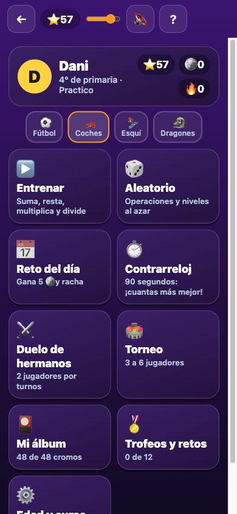
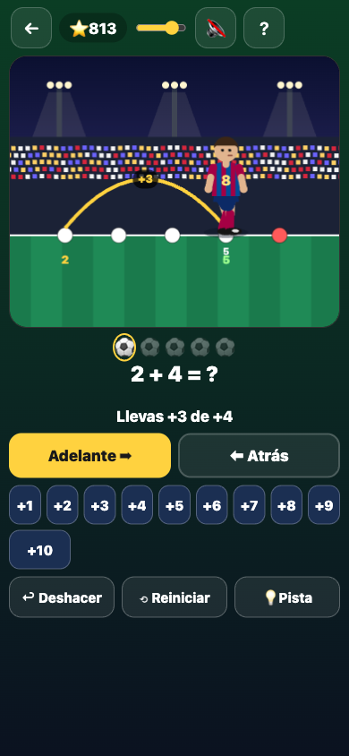
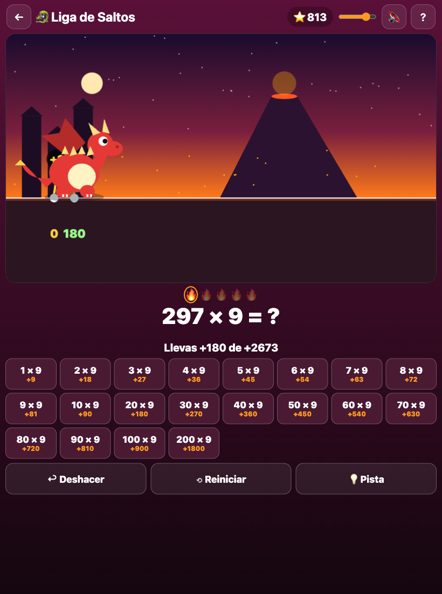
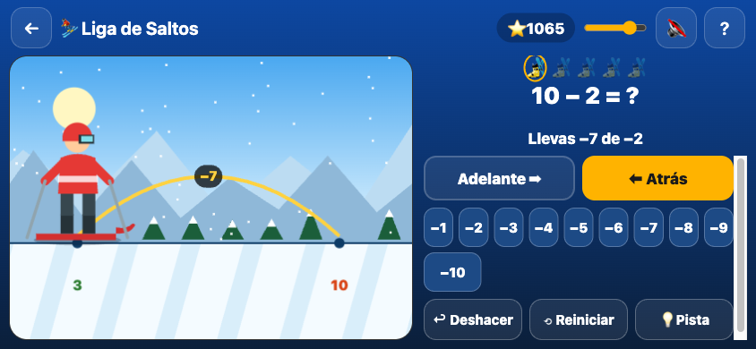

# Liga de Saltos ⚽🏎️⛷️🐉

Juego de **cálculo mental con saltos en la línea numérica** para niños de **1º a 6º de primaria**, siguiendo el método de saltos de [Innovamat](https://www.innovamat.com/). Funciona **sin conexión** en iPhone, iPad, Samsung/Android y ordenador, en vertical y horizontal.

**Jugar:** https://dochoadi.github.io/innovamat-juego/

| Inicio | Collar de bolas (1º) | Multiplicar por partes (4º) | Esquí horizontal (6º) |
|---|---|---|---|
|  |  |  |  |

## Qué incluye
- **Las 4 operaciones con saltos:** sumar (descomponer y compensar), restar (quitar saltando atrás o medir la distancia), multiplicar (saltos repetidos y, desde 4º, por partes tipo modelo rectangular) y dividir (¿cuántos saltos caben?, con resto desde 5º).
- **Edad y curso:** al crear al jugador se pide la edad (5–12) y se propone el curso (editable). Cada curso tiene 3 niveles (*Aprendo, Practico, Reto*) y la dificultad se adapta sola (3 partidos con 13+ ⭐ suben; 2 con 6 o menos bajan).
- **Apoyo visual como en Innovamat:** collar de bolas (1º–2º) → marcas de decenas → línea casi vacía (3º) → línea vacía (4º–6º). Decimales en 5º–6º y números negativos (termómetro) en 6º.
- **4 mundos:** Fútbol, Coches, Esquí y Dragones, con fondos con parallax y sprites animados.
- **Modos:** Entrenar (8 modos), Aleatorio, «Todos los cursos» (1º–6º al azar), Reto del día, Contrarreloj, **Duelo de hermanos** (2 jugadores por turnos) y **Torneo** (3–6 jugadores) en el mismo dispositivo, con marcador de la casa.
- **Recompensas y retos:** estrellas por usar pocos saltos, cromos (12 por mundo), sobres sorpresa con monedas 🪙, 12 trofeos, racha diaria 🔥 y 3 retos semanales.
- **Varios jugadores** con su propio progreso, copia de seguridad (código para pasar el progreso a otro dispositivo) y música/efectos con volumen.

## Instalar en el iPad / iPhone / Samsung (con icono y sin conexión)
1. Abre **https://dochoadi.github.io/innovamat-juego/**
   - **iPad/iPhone:** en **Safari** → Compartir → **Añadir a pantalla de inicio**.
   - **Samsung/Android:** en **Chrome** → menú ⋮ → **Instalar aplicación**.
2. Ábrelo una vez con internet. Después funciona sin conexión.
3. Si sale una versión antigua: ciérralo del todo y ábrelo con internet unos segundos (se actualiza solo).

### Jugar en local desde el móvil
- **En tu wifi:** en el ordenador, dentro de esta carpeta, `python3 -m http.server 8000` y abre `http://IP-DEL-ORDENADOR:8000` en el móvil (sin modo sin conexión).
- **Solo el fichero:** `index.html` es autocontenido. En Android ábrelo con Chrome; en iOS Safari no abre ficheros locales (hace falta una app tipo *Documents by Readdle*).
- Si no suena en iPhone: quita el modo silencio y toca la pantalla una vez.

## El progreso no se pierde
Estrellas, victorias y cromos se guardan en el navegador (`localStorage`) con **datos versionados, copia doble y migración** entre versiones. En iOS, Safari y el icono de la pantalla de inicio guardan datos por separado: usa siempre uno o pasa el progreso con **💾 Copia de seguridad**.

## Desarrollo
```bash
python3 build.py             # genera index.html a partir de src/
node tools/test-problems.js  # prueba que todos los problemas (6 cursos x 3 niveles x 7 operaciones) tienen solución con saltos
python3 -m http.server 8000  # probar en local
```
Código fuente en `src/` (problemas, datos, escena, juego, interfaz). Ver [`Context.md`](Context.md) para el diseño y cómo ampliar. Sin dependencias, sin trackers, sin claves; ningún dato sale del dispositivo.
